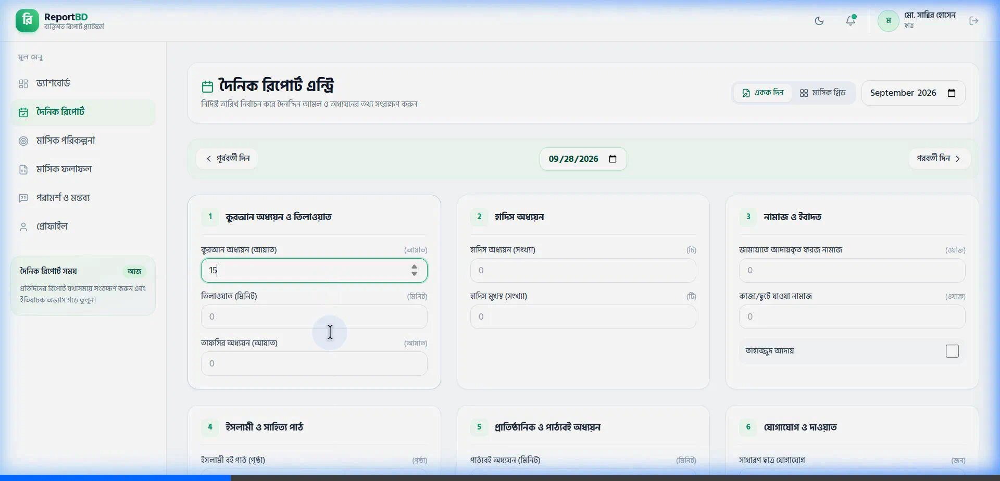
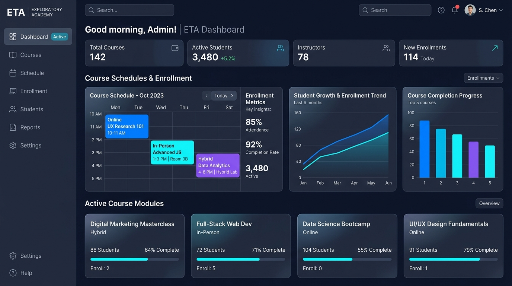
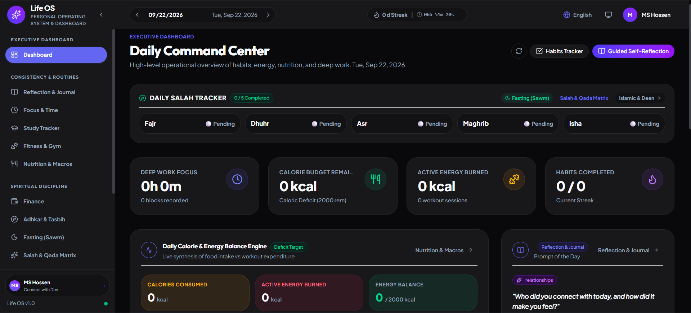

# Md. Sabbir Hossen — Developer Portfolio

[](https://react.dev/)
[](https://vite.dev/)
[](https://tailwindcss.com/)
[](https://www.framer.com/motion/)
[](https://msabbirhossen.github.io/)
[](https://msabbirhossen.github.io/llms.txt)

> **Recruiter-focused, interactive developer portfolio showcasing full-stack MERN engineering, frontend craftsmanship, and production-tested web applications.**

---

## 📌 Table of Contents

- [Overview](#-overview)
- [Live Preview & Key Links](#-live-preview--key-links)
- [Core Architecture & Highlights](#-core-architecture--highlights)
- [Key Features](#-key-features)
- [Technology Stack](#-technology-stack)
- [Repository Structure](#-repository-structure)
- [Featured Projects](#-featured-projects)
- [Getting Started & Local Setup](#-getting-started--local-setup)
- [Environment Configuration](#-environment-configuration)
- [Development Workflow & Scripts](#-development-workflow--scripts)
- [CI/CD & Deployment](#-cicd--deployment)
- [AI Agents & LLM Integration](#-ai-agents--llm-integration)
- [Author & Professional Identity](#-author--professional-identity)
- [License](#-license)

---

## 🧭 Overview

This repository hosts the personal developer portfolio and technical showcase of **Md. Sabbir Hossen**, a **Junior MERN Stack Developer** and undergraduate Computer Science student at the **Islamic University of Madinah**, Saudi Arabia.

Rather than relying on generic landing-page templates or synthetic wireframes, this portfolio is engineered as a high-performance **Single Page Application (SPA)** that presents verifiable, production-ready full-stack software. It communicates engineering depth, defensive security practices, architectural discipline, and community leadership through an accessible, interactive interface.

### Target Audiences

1. **Technical Recruiters & Hiring Managers:** Rapid evaluation of core capabilities via the dedicated [Recruiter Candidate Dossier](https://msabbirhossen.github.io/recruiter), verified credentials, resume download, and fast-track WhatsApp communication.
2. **Software Engineers & Technical Leads:** Direct access to monorepo architectures, Zod schema validation boundaries, optimistic concurrency mechanisms, and public GitHub codebases.
3. **AI Coding Agents & Web Crawlers:** Direct machine-readable context ingestion via standard [`/llms.txt`](https://msabbirhossen.github.io/llms.txt).

---

## 🚀 Live Preview & Key Links

- 🌐 **Live Website:** [https://msabbirhossen.github.io](https://msabbirhossen.github.io)
- 📋 **Recruiter Dossier:** [https://msabbirhossen.github.io/recruiter](https://msabbirhossen.github.io/recruiter)
- 🧭 **Interactive Portfolio Guide:** [https://msabbirhossen.github.io/guide](https://msabbirhossen.github.io/guide)
- 🤖 **Machine Context:** [https://msabbirhossen.github.io/llms.txt](https://msabbirhossen.github.io/llms.txt)
- 📄 **Verified Resume:** [Download PDF](https://msabbirhossen.github.io/resume/Md_Sabbir_Hossen_Resume.pdf)

### Production Previews

|                                  Flagship 01: Report BD                                  |                               Flagship 02: ETA LMS                                |                                   Flagship 03: Life OS                                    |
| :--------------------------------------------------------------------------------------: | :-------------------------------------------------------------------------------: | :---------------------------------------------------------------------------------------: |
|  |  |  |
|                                 **Monorepo & Reporting**                                 |                                **EdTech Platform**                                |                                      **Personal OS**                                      |

---

## ⚡ Core Architecture & Highlights

- **React 19 & Vite 8:** Sub-second cold starts, Rollup-optimized manual chunk splitting (`react`, `router`, `motion`, `ui`), and minimal bundle weight.
- **Tailwind CSS v4 Design System:** Modern semantic tokens defined via CSS custom variables (`text-primary`, `surface`, `border-default`, `accent-primary`), ensuring cohesive dark and light surfaces.
- **Accessible Motion Design:** Framer Motion animations with native `prefers-reduced-motion` handling, custom entrance reveals, and responsive transitions.
- **Zero-Flash Theme Switching:** System-aware theme state (`dark` / `light` / `system`) persisting in `localStorage` with inline script injection to prevent FOUC (flash of unstyled content).
- **Interactive Onboarding Modal:** Centralized 8-stage guided tour modal with step spine, keyboard accessibility (`Escape`, arrow keys), and URL deep-linking support (`?tour=true`).
- **Direct WhatsApp Communication:** Structured form serialization launching directly into WhatsApp with zero middleman mailer failure points or quota restrictions.

---

## 🌟 Key Features

### 1. Recruiter Fast-Track Dossier (`/recruiter`)

- Executive candidate summary highlighting availability for Junior Full-Stack, Frontend, and Backend roles.
- Core MERN competencies matrix linked directly to active codebases.
- One-click CV download and pre-filled WhatsApp hiring notes.

### 2. Interactive Portfolio Guide (`/guide` & `?tour=true`)

- **8-Step Tour Modal:** Guided overlay walking visitors through flagship projects, skill evidence, credentials, and recruiter tools.
- **11-Section In-Page Walkthrough:** Comprehensive documentation featuring active scroll-spy navigation, reading progress bar, project screenshots, and troubleshooting accordions.

### 3. Flagship Project Case Studies (`/projects/:slug`)

- Detailed architectural write-ups breaking down monorepo structures, technical challenges, lessons learned, and system highlights.
- Direct links to verified public GitHub repositories and live production deployments.

### 4. Interactive Skills & Project Evidence

- Skills grouped into logical domains (Frontend, Backend & Database, Languages & Fundamentals, Tools & Workflow).
- Grounded in production code: selecting or inspecting any skill highlights which active projects implement it.

### 5. Verified Academic & Mentorship Milestones

- B.Sc. in Computer Science & Information record at the Islamic University of Madinah.
- 5 verified technical credentials issued by Programming Hero and Udemy with credential IDs.
- Documented community leadership across an 8,000+ member scholarship applicant network (~350 candidates guided, 51 selected, 15 visas finalized in 2026).

### 6. Developer Hub & WhatsApp Note Generator (`/developer`)

- Interactive note builder allowing visitors to pre-compose inquiries by topic (Recruiter, Collaboration, Mentorship, Feedback) and launch directly into WhatsApp.

---

## 🛠️ Technology Stack

### Frontend Core & UI

- **Library:** [React 19](https://react.dev/) (`^19.2.7`)
- **Routing:** [React Router 7](https://reactrouter.com/) (`^7.18.0`)
- **Build Tool:** [Vite 8](https://vite.dev/) (`^8.1.0`)
- **Styling:** [Tailwind CSS v4](https://tailwindcss.com/) (`^4.3.2`) with `@tailwindcss/vite`
- **Motion & Animations:** [Framer Motion](https://www.framer.com/motion/) (`^12.42.0`)
- **SEO & Head Management:** [React Helmet Async](https://github.com/staylor/react-helmet-async) (`^3.0.0`)
- **Form Handling:** [React Hook Form](https://react-hook-form.com/) (`^7.80.0`)
- **Icons:** [React Icons](https://react-icons.github.io/react-icons/) (`^5.7.0`)

### Automation & Prebuild

- **Runtime:** Node.js 22 (ESM modules)
- **Prebuild Engine:** `scripts/prebuild.mjs` generating `public/sitemap.xml`, `public/llms.txt`, and `public/robots.txt`
- **Stats Synchronizer:** `scripts/update-stats.js` fetching real-world GitHub metrics via GitHub API into `public/stats.json`

### Code Quality & Standards

- **Linter:** ESLint 9 (Flat Config) with `eslint-plugin-react`, `eslint-plugin-react-hooks`, and `eslint-plugin-prettier`
- **Formatter:** Prettier (`^3.9.3`)
- **Static Analysis:** Oxlint

### Hosting & Infrastructure

- **Platform:** GitHub Pages
- **Continuous Deployment:** GitHub Actions (`.github/workflows/deploy.yml`)
- **Periodic Automation:** GitHub Actions Cron (`.github/workflows/update-github-stats.yml`)

---

## 📁 Repository Structure

```text
Portfolio/
├── .github/
│   └── workflows/
│       ├── deploy.yml                   # Automated GitHub Pages deployment pipeline
│       └── update-github-stats.yml      # Cron workflow updating public/stats.json
├── public/
│   ├── resume/
│   │   └── Md_Sabbir_Hossen_Resume.pdf  # Verified developer resume
│   ├── screenshots/                     # Verified production application screenshots
│   │   ├── reportbd-daily-flow.png
│   │   ├── eta-dashboard.png
│   │   ├── life-os-dashboard.png
│   │   └── ...
│   ├── llms.txt                         # Generated plaintext context file for LLMs
│   ├── robots.txt                       # Search engine crawler rules
│   ├── sitemap.xml                      # Generated 16-route XML sitemap
│   └── stats.json                       # Cached GitHub repository & contribution statistics
├── scripts/
│   ├── prebuild.mjs                     # Pre-build orchestrator (sitemap + llms.txt)
│   ├── generate-sitemap.mjs             # Dynamic sitemap builder
│   ├── generate-llms-txt.mjs            # Standardized llms.txt context builder
│   ├── resolve-src-imports.mjs          # Node loader for extensionless ESM imports
│   └── update-stats.js                  # GitHub API stats updater
├── src/
│   ├── assets/                          # Static branding, banners, and profile images
│   ├── components/                      # Modular UI components
│   │   ├── about/                       # About section components
│   │   ├── animations/                  # Motion primitives (Reveal, etc.)
│   │   ├── common/                      # Shared design tokens (Badge, Button, Card, Typography)
│   │   ├── contact/                     # WhatsApp-first contact form and direct links
│   │   ├── experience/                  # Career timeline and community leadership
│   │   ├── footer/                      # Modernized global footer with site directory
│   │   ├── github/                      # Verified GitHub stats visualizer
│   │   ├── guide/                       # Interactive 8-step onboarding modal
│   │   ├── hero/                        # Hero section with status badges & fast jump
│   │   ├── layout/                      # Navbar, mobile drawer, SectionWrapper
│   │   ├── project-details/             # Case study layout and architecture displays
│   │   ├── projects/                    # Featured projects grid and filtering
│   │   └── skills/                      # Interactive skills grid with project evidence
│   ├── config/                          # Motion and transition configuration
│   ├── contexts/                        # ThemeContext & PortfolioGuideContext
│   ├── data/                            # Single source of truth for portfolio content
│   │   ├── certifications/              # 5 verified technical credentials
│   │   ├── education/                   # Islamic University of Madinah record
│   │   ├── experience/                  # Timeline entries and community leadership
│   │   ├── personal/                    # Personal info, vision, and contact channels
│   │   ├── projects/                    # Project registry (Report BD, ETA, Life OS, etc.)
│   │   ├── skills/                      # Technology categorization & evidence mapping
│   │   ├── guideData.js                 # 8-step interactive tour data
│   │   ├── index.js                     # Unified portfolioData export
│   │   └── navigation.js                # Canonical route registry
│   ├── hooks/                           # Custom React hooks (useAIChat, useCountAnimation)
│   ├── layouts/                         # MainLayout shell
│   ├── lib/                             # Utility helpers, motion libraries, and AI helpers
│   ├── pages/                           # Application route views
│   │   ├── Home.jsx                     # Interactive homepage (/)
│   │   ├── Projects.jsx                 # Filterable projects catalog (/projects)
│   │   ├── ProjectDetails.jsx           # Deep case studies (/projects/:slug)
│   │   ├── Experience.jsx               # Career timeline & leadership (/experience)
│   │   ├── Education.jsx                # Academic credentials (/education)
│   │   ├── Certifications.jsx           # 5 verified certificates (/certifications)
│   │   ├── Developer.jsx                # Developer & Community Hub (/developer)
│   │   ├── Recruiter.jsx                # Recruiter candidate dossier (/recruiter)
│   │   ├── Guide.jsx                    # 11-section Portfolio Guide (/guide)
│   │   └── NotFound.jsx                 # Accessible 404 page (*)
│   ├── App.jsx                          # Route provider and global modal mounting
│   ├── index.css                        # Tailwind v4 theme tokens and semantic utilities
│   └── main.jsx                         # React 19 root bootstrap
├── .env.example                         # Example environment variables
├── eslint.config.js                     # ESLint flat config
├── package.json                         # Project dependencies and npm scripts
├── vite.config.js                       # Vite 8 build and chunk splitting configuration
└── README.md                            # Comprehensive project documentation
```

---

## 🏆 Featured Projects

### 1. Report BD (BPS Report) — Full-Stack Monorepo Mentorship Platform

- **Role:** Full-Stack Lead Developer · **Order:** `featuredOrder: 1`
- **Overview:** A multi-tenant, mobile-first personal reporting and institutional mentorship platform built as an npm workspace monorepo. Features deterministic monthly calculation derivations, optimistic revision locking (HTTP 409 Conflict), supervisor review queues with atomic transitions, two-way threaded mentorship advice, idempotent notification dispatching, immutable administrative audit logs with recursive metadata sanitization, and complete trilingual internationalization (Bengali, English, Arabic RTL).
- **Tech Stack:** TypeScript, React 19, Express 4 API, Node.js, MongoDB Atlas, Firebase Auth, Tailwind CSS, Zod Validation, Vite.
- 🔗 **Case Study:** [/projects/report-bd](https://msabbirhossen.github.io/projects/report-bd) | 🌐 **Live Demo:** [personalreport-iota.vercel.app](https://personalreport-iota.vercel.app/) | 💻 **Repository:** [github.com/MSabbirHossen/personalreport](https://github.com/MSabbirHossen/personalreport)

---

### 2. Exploratory Training Academy (ETA) — Full-Stack EdTech LMS

- **Role:** Full-Stack Lead Developer · **Order:** `featuredOrder: 2`
- **Overview:** An enterprise-grade, multi-tenant academic and training operating system consolidating curriculum authoring, interactive examinations with server-authoritative timer expiry, live attendance recording, GPA gradebook publishing with cryptographic publishing locks, guardian monitoring, and bilingual (English / Arabic RTL) layout systems.
- **Tech Stack:** React 19, Redux Toolkit, Node.js, Express, MongoDB Atlas, Firebase Auth, Tailwind CSS v4, Framer Motion.
- 🔗 **Case Study:** [/projects/eta-digital-education-platform](https://msabbirhossen.github.io/projects/eta-digital-education-platform) | 🌐 **Live Demo:** [eta-web-omega.vercel.app](https://eta-web-omega.vercel.app/) | 💻 **Repository:** [github.com/MSabbirHossen/ETA](https://github.com/MSabbirHossen/ETA)

---

### 3. Life OS — Personal Productivity & Habit Operating System

- **Role:** Solo Developer · **Order:** `featuredOrder: 3`
- **Overview:** A production-ready, single-user personal operating system bringing journaling, finance, habit heatmaps, fitness, goals, Islamic tracking (Salah, Quran), study management, and visual analytics into one unified dashboard. Includes date-indexed MongoDB collections for ultra-fast queries and one-click encrypted JSON export for 100% personal data ownership.
- **Tech Stack:** React, Vite, Node.js, Express, MongoDB, Mongoose, JWT Auth, Recharts, Tailwind CSS.
- 🔗 **Case Study:** [/projects/life-os](https://msabbirhossen.github.io/projects/life-os) | 🌐 **Live Demo:** [lifeosclient.vercel.app](https://lifeosclient.vercel.app) | 💻 **Repository:** [github.com/MSabbirHossen/Life-OS](https://github.com/MSabbirHossen/Life-OS)

---

### Additional Notable Projects

| Project                  | Domain                       | Stack                                                             | Links                                                                                                                     |
| :----------------------- | :--------------------------- | :---------------------------------------------------------------- | :------------------------------------------------------------------------------------------------------------------------ |
| **Digital Life Lessons** | Growth & Insights Platform   | React 18, Node.js, Express, MongoDB, Firebase, Stripe API         | [Demo](https://digital-life-lessons-client.vercel.app/) · [GitHub](https://github.com/MSabbirHossen/Digital-Life-Lessons) |
| **Import Export Hub**    | B2B Marketplace              | React 18, Node.js, Express, MongoDB Atlas, Firebase Admin SDK     | [Demo](https://import-export-hub-client.vercel.app/) · [GitHub](https://github.com/MSabbirHossen/export-import-project)   |
| **MovieExplorer**        | Entertainment Discovery      | React 19, Vite, Tailwind v4, Context API, TVMaze REST API         | [Demo](https://movieexplorer-pink.vercel.app) · [GitHub](https://github.com/MSabbirHossen/movieExplorer)                  |
| **GameHub**              | Indie & AAA Gaming Directory | React 19, Vite, Firebase, Tailwind CSS v4, DaisyUI, Framer Motion | [Demo](https://online-game-library.web.app/) · [GitHub](https://github.com/MSabbirHossen/Online-Game-Library)             |
| **Personal App Store**   | Software Showcase Portal     | React 19, Vite, Tailwind CSS v4                                   | [Demo](https://app-store-ten-virid.vercel.app/) · [GitHub](https://github.com/MSabbirHossen/app-store)                    |

---

## 💻 Getting Started & Local Setup

### Prerequisites

- **Node.js:** `v20.x` or `v22.x` (Node 22 LTS recommended)
- **Package Manager:** `npm` (`v10.x` or later)
- **Version Control:** `git`

### 1. Clone the Repository

```bash
git clone https://github.com/MSabbirHossen/Portfolio.git
cd Portfolio
```

### 2. Install Dependencies

```bash
npm install
```

### 3. Environment Setup (Optional)

```bash
cp .env.example .env
```

_(Optional: EmailJS credentials can be added to `.env` if testing direct email fallback. Primary contact defaults seamlessly to WhatsApp without environment keys.)_

### 4. Start Local Development Server

```bash
npm run dev
```

The application will launch at `http://localhost:5173`.

### 5. Create Production Build

```bash
npm run build
```

Runs the automated prebuild pipeline (generating `public/sitemap.xml`, `public/llms.txt`, and `public/robots.txt`), then bundles optimized static assets into `./dist`.

### 6. Preview Production Build Locally

```bash
npm run preview
```

---

## ⚙️ Environment Configuration

| Variable                   | Scope           | Required | Purpose                                                                                     |
| :------------------------- | :-------------- | :------: | :------------------------------------------------------------------------------------------ |
| `VITE_EMAILJS_SERVICE_ID`  | Client (`.env`) | Optional | EmailJS service identifier for secondary email form fallback.                               |
| `VITE_EMAILJS_TEMPLATE_ID` | Client (`.env`) | Optional | EmailJS template identifier for email formatting.                                           |
| `VITE_EMAILJS_PUBLIC_KEY`  | Client (`.env`) | Optional | EmailJS public API key.                                                                     |
| `GH_TOKEN`                 | CI / CLI        | Optional | GitHub personal access token used by `npm run update-stats` to refresh `public/stats.json`. |
| `VITE_BASE_PATH`           | Build           | Optional | Custom base URL path for Vite (defaults to `/`).                                            |

---

## 🔄 Development Workflow & Scripts

| Command                | Description                                                                             |
| :--------------------- | :-------------------------------------------------------------------------------------- |
| `npm run dev`          | Starts the Vite local development server with Hot Module Replacement (HMR).             |
| `npm run prebuild`     | Generates updated `sitemap.xml`, `llms.txt`, and `robots.txt` before bundling.          |
| `npm run build`        | Runs `prebuild` and compiles the production client into `dist/`.                        |
| `npm run preview`      | Serves the local `dist/` build for production verification.                             |
| `npm run lint`         | Runs ESLint 9 across all `src/` files to ensure clean code quality.                     |
| `npm run format`       | Formats all codebase files according to Prettier guidelines.                            |
| `npm run update-stats` | Fetches verified GitHub contributions, stars, and PRs via GitHub API into `stats.json`. |

---

## 🚀 CI/CD & Deployment

The portfolio is deployed to **GitHub Pages** using an automated GitHub Actions pipeline:

- **Deployment Workflow (`.github/workflows/deploy.yml`):**
  - Triggers automatically on push to the `main` branch or upon successful completion of the GitHub Stats update workflow.
  - Checks out repository and sets up Node.js 22 with npm cache.
  - Executes `npm run build` (running prebuild metadata generators and Vite Rollup bundler).
  - Uploads the `dist/` directory artifact and deploys directly to GitHub Pages via `actions/deploy-pages@v4`.

- **GitHub Stats Automation (`.github/workflows/update-github-stats.yml`):**
  - Runs automatically on a 12-hour schedule (`0 */12 * * *`) or via manual workflow dispatch.
  - Executes `npm run update-stats` with `GH_TOKEN`, commits updated metrics to `public/stats.json`, and triggers an automated redeployment.

---

## 🤖 AI Agents & LLM Integration

This portfolio adopts modern web standards for AI coding assistants, agents, and scrapers:

- **`public/llms.txt`:** Standardized plaintext markdown profile generated automatically during `prebuild` via `scripts/generate-llms-txt.mjs`.
- **Structured Content:** LLM agents (ChatGPT, Claude, Gemini, Antigravity) can read `https://msabbirhossen.github.io/llms.txt` directly to ingest Sabbir's verified technical competencies, flagship projects, and architectural highlights without parsing client-rendered JavaScript.

---

## 👨‍💻 Author & Professional Identity

**Md. Sabbir Hossen**  
_Junior MERN Stack Developer · Frontend Craftsmanship · Full-Stack JavaScript_  
_Computer Science Student at the Islamic University of Madinah, Saudi Arabia_

- 🌐 **Portfolio:** [https://msabbirhossen.github.io](https://msabbirhossen.github.io)
- 💼 **LinkedIn:** [linkedin.com/in/sabb1rhossen](https://www.linkedin.com/in/sabb1rhossen/)
- 💻 **GitHub:** [github.com/MSabbirHossen](https://github.com/MSabbirHossen)
- 💬 **WhatsApp:** [+8801773511874](https://wa.me/+8801773511874)
- 📧 **Email:** [mshossen724@gmail.com](mailto:mshossen724@gmail.com)

---

## 📄 License

This repository and its original portfolio source code are proprietary:  
© 2026 **Md. Sabbir Hossen**. All rights reserved.

_Open-source projects and external libraries referenced throughout this portfolio are governed by their respective licenses._
